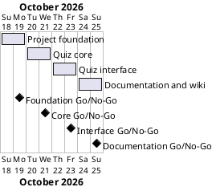

# Project Plan: Quizzler

## Metadata
| Key | Value |
| --- | --- |
| ID | PP-001 |
| CrossReference | [BC-001], [SA-001], [MIL-001], [MIL-002], [MIL-003], [MIL-004] |
| Language | en |
| Domain | it |

## Version History
| Date | Status | Author | Reviewer | Change | Commit |
| --- | --- | --- | --- | --- | --- |
| 2026-10-18 | Accepted | Jens Tirsvad Nielsen | S01 | Initial version, accepted by the Product Owner with the plan | [2133243] |

---

## Purpose

Schedules the four gateways that deliver Quizzler within the Business Case window of 2026-10-18 to 2026-10-25 ([BC-001]). Each gateway is one milestone document, one Milestone on the git host and one pull request.

## Planning Assumptions

- Week 1 starts 2026-10-18; the plan ends by 2026-10-25, per the Business Case constraint.
- Phase length: two days per gateway. S01 is the only owner and reviewer ([SA-001]); the AI acts as stand-in author and reviewer in autonomous mode.
- The baseline (Business Case, Stakeholder Analysis, Project Plan, governance, dictionary, ADR-0001, milestones) is accepted when the user accepts this plan in chat; MIL-001 starts after that.

## Gateway Schedule

| Gateway | Document | Window | Decision date | Owner | Stories | Main deliverable | Milestone |
| --- | --- | --- | --- | --- | --- | --- | --- |
| Project foundation | [MIL-001] | 2026-10-18 to 2026-10-19 | 2026-10-19 | S01 | none | Configuration, skeleton, README, repository description and topics | |
| Quiz core | [MIL-002] | 2026-10-20 to 2026-10-21 | 2026-10-21 | S01 | none | Question model, quiz logic, API client, tests | |
| Quiz interface | [MIL-003] | 2026-10-22 to 2026-10-23 | 2026-10-23 | S01 | none | Tkinter interface, answer checking, entry point | |
| Documentation and wiki | [MIL-004] | 2026-10-24 to 2026-10-25 | 2026-10-25 | S01 | none | Screenshots, README, wiki in three languages | |



## Scope Coverage

| Business Case scope item | Gateway |
| --- | --- |
| Question model, quiz logic, API client | MIL-002 |
| Answer checking and Tkinter interface, entry point | MIL-003 |
| Project configuration, folder structure, `constants.py`, `Doxyfile` | MIL-001 |
| pytest tests | MIL-001 (set-up), MIL-002 and MIL-003 (tests) |
| README with run and test instructions | MIL-001 (first version), MIL-004 (finished) |
| Screenshot, wiki in three languages | MIL-004 |
| Repository description and topics | MIL-001 |

## Dependencies

```
MIL-001 → MIL-002 → MIL-003 → MIL-004
```

A No-Go on a gateway stops the chain: later windows move by the days needed to fix it, and the Business Case window is renegotiated with S01 if it runs past 2026-10-25.

## Plan Risks

| Risk | Impact | Mitigation |
| --- | --- | --- |
| The git host API or token fails when setting description and topics | MIL-001 cannot close criterion 6 | The tool stops and reports; S01 sets them by hand in the web UI |
| A required CI check on the host fails for a reason outside the project | A pull request cannot merge | Stop after three attempts on the same cause and report, as AGENTS.md requires |
| Screenshots need a desktop session | MIL-004 delay | Capture on S01's own Windows desktop with the application window only |

## Open Issues

- The repository URL in the request (`Tirsvad-Udemy-100_days_of_code`) differs from `origin` (`Tirsvad-Udemy-100-days-of-code/034-quizzler`); the plan uses `origin`.
- Bahasa Malaysia text cannot be checked by S01 or the AI as a reader of the language; it stays flagged as unchecked in the wiki.

---

[BC-001]: ./business-case.md
[SA-001]: ./stakeholder-analysis.md
[MIL-001]: ./milestones/mil-001-project-foundation.md
[MIL-002]: ./milestones/mil-002-quiz-core.md
[MIL-003]: ./milestones/mil-003-quiz-interface.md
[MIL-004]: ./milestones/mil-004-documentation-and-wiki.md
[2133243]: https://git.tirsystem.com/Tirsvad-Udemy-100-days-of-code/034-quizzler/commit/21332432e3c81336344ef3dbc71123aab76c9cfb
